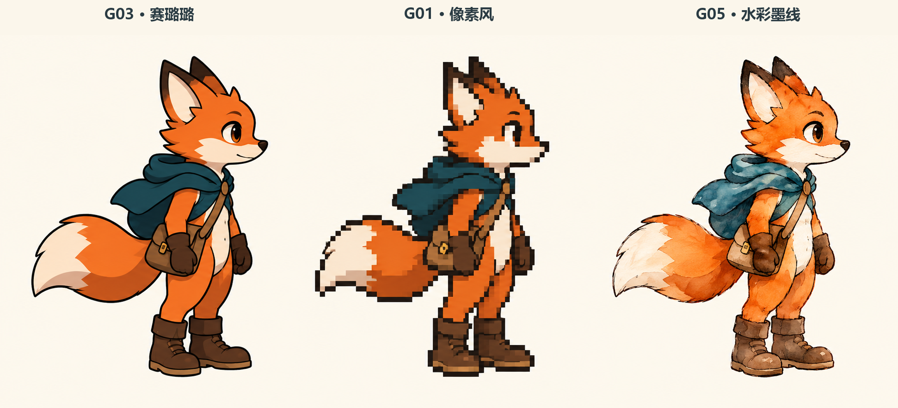

# GPT Image 2D 美术与可选风格

把“选画风 → 生成资源 → 检查透明与边缘 → 切分交付”连成一个 Codex 工作流。

- 主入口：`gpt-image-2d-assets`。
- 配套风格库：`handdraw-style-prompter`，保留 001–261 原风格编号，新增 G01–G24 游戏风格配方。
- 支持自定义参考、主次风格混合、角色/图标/场景/组件、成组动作和特效。
- 保持主模型负责规划与实际看图审核，视觉生成只走内置 GPT Image。

## 核心演示：3×3 连续动作 → GIF


九宫格成组生成，按真实尺寸切出 9 帧，以每帧 90 ms 合成 810 ms GIF。保留首次生成和定向修改版本。此图是动作候选预览，步态仍需继续复核，不等于引擎或用户验收通过。

[3×3 原始动作表](examples/fox-motion/fox-run-3x3-v2.png) · [裁切与时序](examples/fox-motion/sequence-v2.json) · [记录](examples/fox-motion/record.json)

## 同一个角色，三种画风



固定狐狸身份、服装和站姿，比较 G03 赛璐璐、G01 像素风、G05 水彩墨线。像素风是方向预览，不冒充逐像素制作验收。

[公众号图文介绍](docs/wechat-article.md)

## 成套道具演示


> 使用 $gpt-image-2d-assets，以 G03 为主，结合 G10 的剪纸造型，生成药水、钥匙、宝石、卷轴四个背包道具。统一光照，背景透明，并检查小尺寸表现。

演示实际得到 1254×1254 RGBA 图片，Alpha 范围 0–255，已检查原图和深浅底色，附四张无损裁图。画面偏多面厚涂，剪纸次级特征较弱；这是流程演示，不是风格精准度、游戏实机或用户验收保证。

[原图](examples/inventory/inventory-sheet.png) · [检查记录](examples/inventory/record.json)

## 安装

需要可调用内置 GPT Image 的 Codex 环境。生成不需要你另行配置图像 API Key；技术检查工具需要 Python 3 和 Pillow。

下载本仓库后，将 `gpt-image-2d-assets` 与 `handdraw-style-prompter` 两个目录并列复制到你的 Codex skills 目录（通常是 `~/.codex/skills/`）。已有同名 skill 时先备份，再按需更新；不要删除原项目。

也可以在 Codex 中说：“请从这个仓库安装 gpt-image-2d-assets 和 handdraw-style-prompter 两个 skill。”

```sh
python -m pip install Pillow
```

## 用法

```text
用 063 风格制作一张机械狐狸角色母版，背景透明。
用 G03 制作同一角色的攻击动作表，检查逐帧和播放效果。
我还没选画风：比较水彩、剪纸和像素，只给建议，先不生图。
以我提供的图为风格参考，保持另一张图里的角色身份。
```

风格浏览：[原图库](handdraw-style-prompter/gallery/index.html) · [游戏风格配方](handdraw-style-prompter/gallery/extensions.html)。HTML 下载后在本地浏览器打开。G 系列是文字配方，除标明的演示外没有逐项验证样图。

```sh
python handdraw-style-prompter/scripts/style_catalog.py --style G03
python handdraw-style-prompter/scripts/style_catalog.py --search 水彩
python gpt-image-2d-assets/scripts/asset_tools.py inspect examples/inventory/inventory-sheet.png --out review-v1
```

## 验证与边界

脚本只做测量、裁切、补边、预览，不画替代美术、不伪造动画帧。透明检查与真实看图分别记录；引擎验证和用户验收单列。提示词模式不自动生图；明确的方向选择边界继续保留。

```sh
python gpt-image-2d-assets/scripts/test_asset_tools.py
```

## 来源

原始 261 风格图库与基础索引来自 [yang0/handraw-style](https://github.com/yang0/handraw-style)，本版保留来源并整合 2D 资产工作流、游戏配方与检查工具。上游基线：`70bf51d6b4c301805dd6c083355a2ad18db1023b`。

原图库图片和作者索引不因本次整合而成为本项目原创；发布包不为上游材料另行授予许可证，也不保证参考图片可直接作为商业游戏资产使用。
