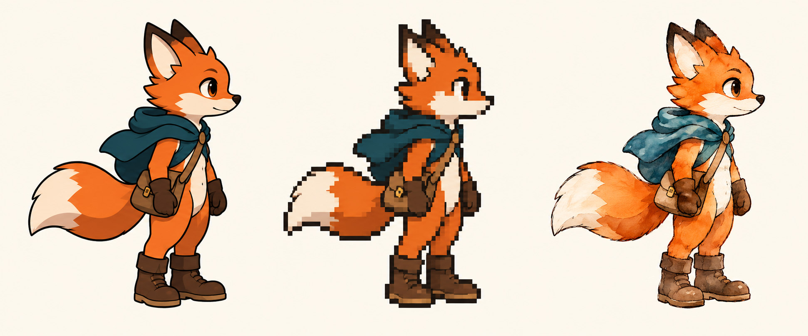

# GPT Image 2D Assets

Pick a style, make a sprite sheet, and turn it into a GIF. A pair of Codex skills for making and reviewing 2D art with built-in GPT Image.

## A fox, nine frames


This demo started as a 3×3 sheet. We cut it into nine PNGs and assembled a loop at 90 ms per frame. The first attempt repeated similar poses, so we generated a revised sheet. Both versions are included. The gait still needs refinement before use in a game.

[Sprite sheet](examples/fox-motion/fox-run-3x3-v2.png) · [Individual frames](examples/fox-motion) · [Timing and crop data](examples/fox-motion/sequence-v2.json)

## Try a different look



Same character, outfit and standing pose: **Clean Cel (G03)**, **Pixel Cluster (G01)** and **Watercolor Ink (G05)**. The pixel version is a visual exploration; it has not been checked as a pixel-perfect game sprite.

Choose from **261 reference styles**, **24 game-art recipes**, your own reference images, or a mix of specific traits.

## What you can make

- Characters, portraits, expressions and action sheets.
- Inventory icons, UI pieces and object states.
- Effects with charge, release, impact and fade stages.
- Backgrounds and tiles, with seam checks when tiling is needed.


The included tools inspect alpha, crop sheets with explicit coordinates, and assemble timed PNG sequences and GIF previews. They do not draw replacement art or invent missing animation frames.

## Install

Use a Codex environment with access to built-in GPT Image. Copy both folders into your Codex skills directory, usually `~/.codex/skills/`:

```text
gpt-image-2d-assets/
handdraw-style-prompter/
```

Back up existing folders with these names before updating. You can also give Codex this repository URL and ask it to install both skills.

The crop and inspection tools need Python 3 and Pillow:

```sh
python -m pip install Pillow
```

## Try it

```text
Use $gpt-image-2d-assets to make a fox courier in G03 style.
Keep the background transparent.

Make a 3×3 run cycle for this fox, facing right.
Cut the sheet into frames and make a GIF preview.

Show this same character in cel, pixel and watercolor styles.
Keep the outfit, camera and pose the same.

Make a matching set of a potion, key, gem and scroll.
Check how they read at inventory-icon size.
```

Start with `gpt-image-2d-assets` for asset production. Use `handdraw-style-prompter` to browse styles or write prompts. A prompt-only request does not trigger image generation.

```sh
python handdraw-style-prompter/scripts/style_catalog.py --style G03
python handdraw-style-prompter/scripts/style_catalog.py --search watercolor
python gpt-image-2d-assets/scripts/asset_tools.py inspect examples/inventory/inventory-sheet.png --out review-v1
```

The selected main model, including Astra, plans the work and reviews the actual images. Built-in GPT Image handles generation and edits. The coordinator model name does not identify the image backend.

## Examples and notes

[How the fox demo was made](docs/fox-demo.md) · [Game style recipes](handdraw-style-prompter/gallery/extensions.html) · [Original gallery](handdraw-style-prompter/gallery/index.html)

Download the HTML galleries and open them locally. Original source annotations remain in Chinese; style IDs, English style names and reference images are preserved. The public skill instructions and guides are in English.

Image generation can drift between frames. Alpha checks, visual review, playback, engine testing and user approval are recorded separately. A successful file check does not establish animation quality or game readiness.

```sh
python gpt-image-2d-assets/scripts/test_asset_tools.py
```

## Credits

The original 261-style library and images come from [yang0/handraw-style](https://github.com/yang0/handraw-style), using baseline `70bf51d6b4c301805dd6c083355a2ad18db1023b`. This repository adds the asset workflow, game-style recipes, inspection tools and demos.

See [the upstream license](UPSTREAM-LICENSE.txt). The reference images and artist index are credited source material, not original artwork by this project. Their inclusion is not a guarantee of rights to use them as commercial game assets.
