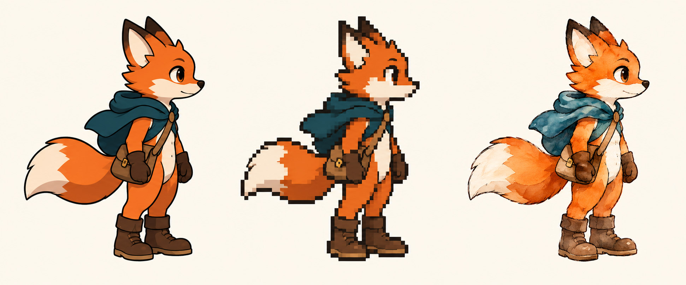
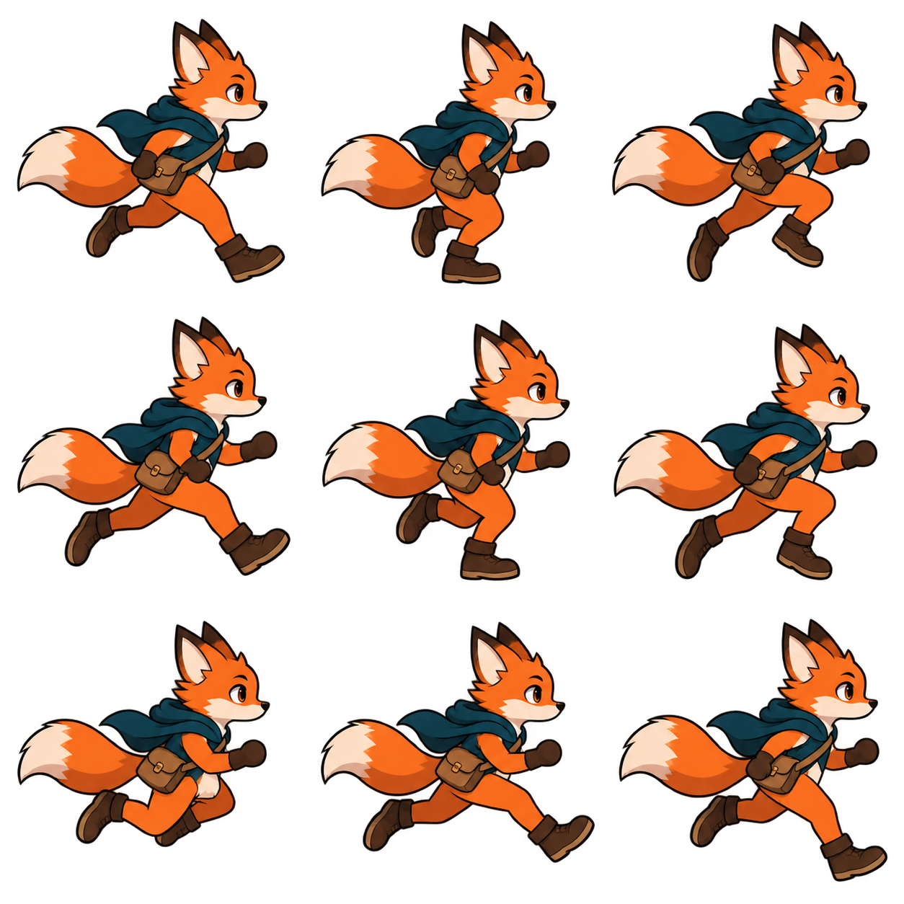
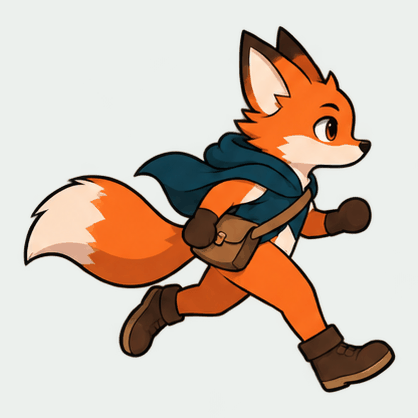
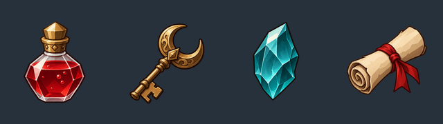

# A fox in three styles, then a short run loop

We combined a style library with a 2D asset workflow and tried it on a fox courier. The source images, prompts and output files are included here.

First, three versions of the same standing character: cel, pixel and watercolor. The outfit, bag and pose stay recognizable across them.

For the motion test, the request was a right-facing run cycle on a 3×3 sheet. The first result had several similar poses. A second generation targeted those missing gait phases.

The revised image is 1254×1254 pixels. It divides into nine 418×418 cells. We cropped them in row order and assembled a GIF at 90 ms per frame, for an 810 ms loop.

This is a motion study. Foot timing and the loop transition still need work before it goes into a game. The files include the first attempt, revised sheet, nine PNGs and timing data so the next pass can start from the actual result.

We also made a matching set of inventory items: a potion, key, gem and scroll. The small preview helps show which details survive at icon size.

The same workflow can be used for expressions, chest states, UI pieces or the stages of a spell. Choose a style, keep the shared design constraints, generate a group, then inspect and split the result.

## Files

- [Motion source files and prompts](../examples/fox-motion)
- [Frame crops and timing](../examples/fox-motion/sequence-v2.json)
- [Motion review record](../examples/fox-motion/record.json)
- [Inventory source and alpha measurements](../examples/inventory)
- [Installation and usage](../README.md)
