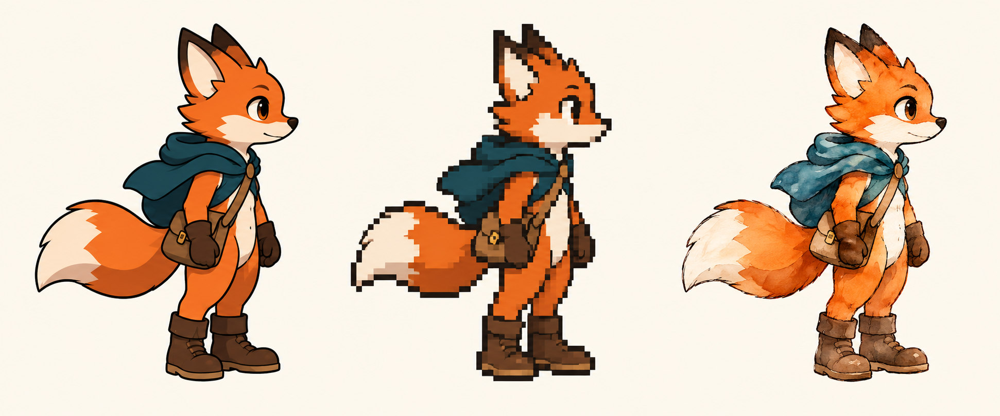

# Share-ready article: Codex 2D art from style choice to a nine-frame GIF

This English article records the same fox courier demo used in the Chinese social-post archive. It combines the style-selection skill with the 2D asset skill in Codex and targets the current GPT-image-2.5 workflow.

The workflow began with Yang's handdraw-style skill and its 261 original reference styles. We later added 24 game-art recipes. The fox keeps its outfit, shoulder bag and standing pose while moving between cel, pixel and watercolor directions.

For motion, the request was a right-facing run on a 3×3 sheet. The first result repeated several poses, so we generated a revised pass. The sheet was cut into nine PNGs and assembled into a 90 ms-per-frame GIF. The source, frames and timing file remain available for another edit.

The GIF is a motion study. Foot timing and the loop seam still need attention before game integration. Playing it makes those issues easier to see than a row of still images.

We also generated a matching potion, key, gem and scroll set. The grouped source keeps palette and lighting closer, while the small preview shows which details survive at icon size.

In Codex, call the skill and describe the style you want. Use a character, a prop or a scene. The same workflow can cover chest states, expressions, skill icons and spell stages from charge to fade.

[Repository and installation](../README.md) · [Full demo notes](fox-demo.md)
