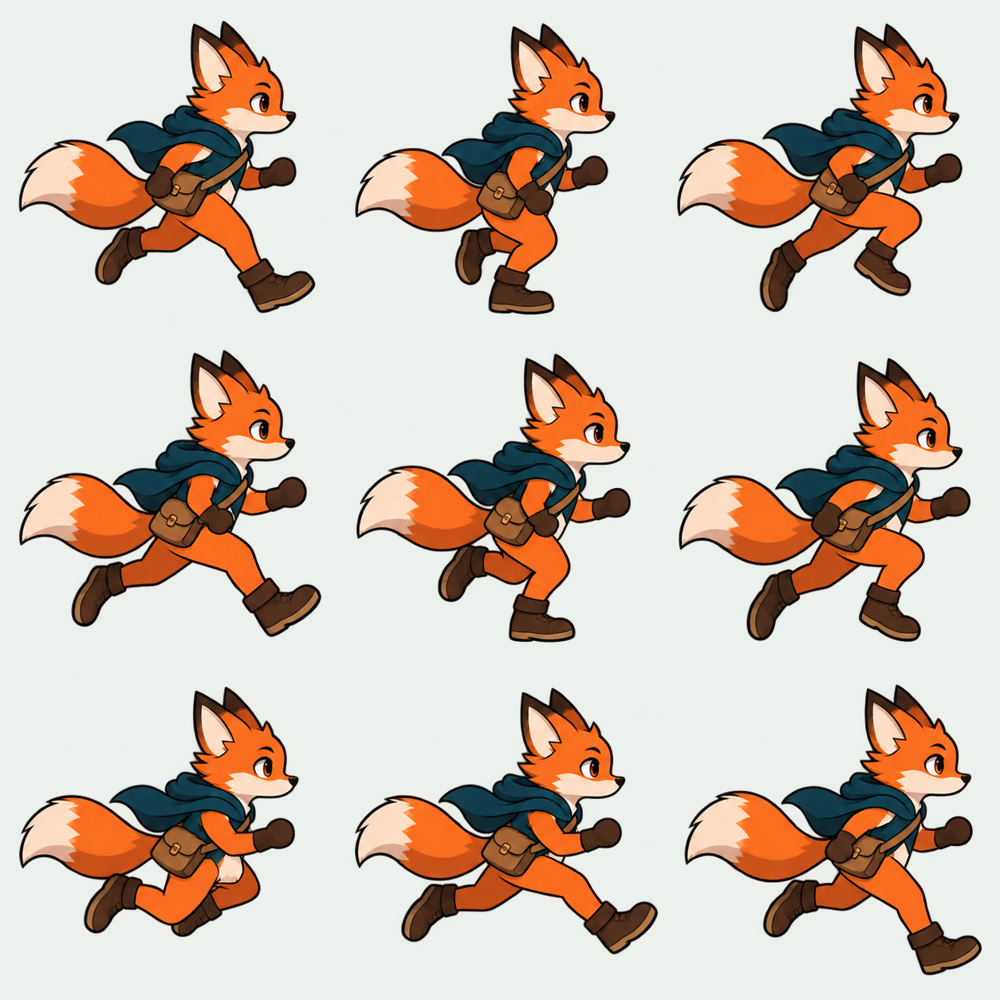
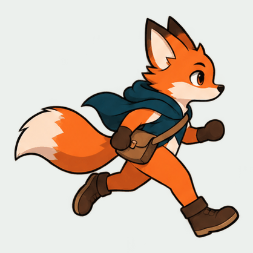
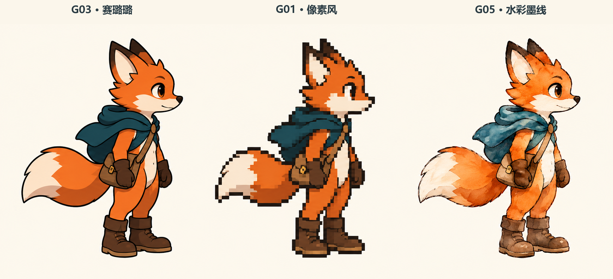
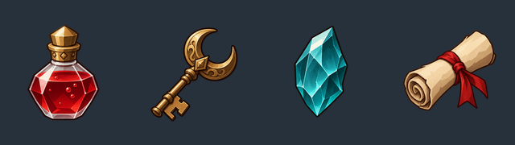

# 同一个角色，三种画风，还能跑起来：我的 AI 美术 Skill 实测

做游戏美术，难的往往不是生成一张漂亮图片，而是让同一个角色换画风、做动作，再把结果整理成能继续使用的资源。我把风格选择与二维资产制作整合成了一个 Skill，这次直接用一只狐狸信使演示它的核心能力。

先让角色动起来。给出“朝右跑步、保持服装和比例、生成三乘三连续动作帧”的要求，技能会把九个动作阶段放在同一张图里。随后读取实际尺寸，确定裁框，切出九张独立图片，按时序合成 GIF。你看到的不再只是角色设定，而是一段可以反复播放、检查节奏的动作预览。

3×3 动作表：按从左到右、从上到下的顺序切帧。

九帧 GIF 候选预览，每帧 90 毫秒；仍需按目标游戏检查步态。

这里的关键不是把九张图机械串起来。支撑腿是否交替、身体有没有忽大忽小、尾巴是否被裁掉、首尾会不会突然跳变，都需要检查。此次狐狸跑步首版就出现了相近姿势重复，我保留原图并针对步态相位重做了一版。因此，GIF 既是展示结果，也是发现动作问题的工具。

再看画风。同一只狐狸、同一套服装、同一站姿，我分别生成了赛璐璐、像素和水彩版本。赛璐璐轮廓清楚、色块利落；像素版以方块和阶梯边缘组织形体；水彩版保留墨线、晕染与纸上笔触。并排对比，比只说“想要可爱一点”更容易选出方向。

同一角色、同一站姿：赛璐璐 / 像素风 / 水彩墨线。

确定画风后，就可以沿着同一个角色继续制作动作。原库保留二百六十一种编号风格，另有二十四种游戏风格配方，也支持自带参考图与主次风格搭配。风格库负责帮助选择视觉语言，资产流程负责把它落到角色、动作和交付文件上。

用途也不止跑步动画：火球可以按蓄力、释放、命中、消散组织成序列；宝箱可以制作关闭、开启、损坏状态；药水、钥匙和宝石可以成组生成，统一配色与光照。头像表情、技能图标和界面组件，也能沿用相同的方法。

其他场景：成套道具、物件状态与特效序列。

最终保留原图、分帧图片、时序数据和 GIF，透明素材再检查真实透明通道与深浅底色表现。九宫格只是常用布局，帧数要服从动作需要。它不会保证一次生成就达到成品标准，但能把“选画风、做动作、看播放、修问题”串成一条可复用的制作流程。

[GitHub：获取完整 Skill 与演示资源](https://github.com/Harrison0223-svg/gpt-image-2d-assets)
